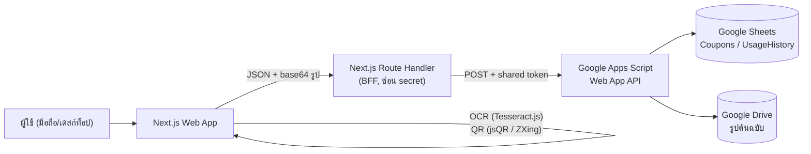

# BRD — Coupon Wallet

| รายการ | รายละเอียด |
|---|---|
| ชื่อโครงการ | Coupon Wallet (กระเป๋าคูปองส่วนลด) |
| เวอร์ชันเอกสาร | 1.0 (MVP implemented) |
| วันที่จัดทำ | 31 ตุลาคม 2026 |
| สถานะ | อนุมัติแล้ว — MVP Phase 1 implemented (ดู `05-setup.md`) |
| ผู้จัดทำ | BA |
| ผู้อนุมัติ | เจ้าของผลิตภัณฑ์ (รอลงนาม) |
| เอกสารที่เกี่ยวข้อง | `02-business-flow.md`, `03-data-model-and-api.md`, `04-acceptance-criteria.md`, `05-setup.md` |

---

## 1. บทสรุปผู้บริหาร

ผู้ใช้มักได้รับคูปองส่วนลดจากแอปต่าง ๆ (Shopping, Food delivery, Mobile banking, LINE) ในรูปแบบ Screenshot ที่กระจัดกระจายอยู่ในแกลเลอรี ทำให้ลืมใช้ ขาดการติดตาม และค้นหาคูปองที่ยังไม่หมดอายุได้ยาก

Coupon Wallet เป็นเว็บแอปที่ให้ผู้ใช้อัปโหลด Screenshot คูปอง ระบบจะอ่านข้อความ (OCR) และ QR Code อัตโนมัติ ตั้งชื่อคูปองให้เอง จากนั้นบันทึกข้อมูลลง Google Sheets พร้อมเก็บรูปต้นฉบับใน Google Drive ผู้ใช้สามารถดูรายการ กรองสถานะ เปิด QR เพื่อใช้ส่วนลด และทำเครื่องหมายว่าใช้แล้วพร้อมบันทึกเวลาที่ใช้

เป้าหมาย MVP: ลดเวลาที่ใช้จัดการคูปองจาก "หาในแกลเลอรี + จำเอง" เหลือ "อัปโหลดครั้งเดียวแล้วค้นหาได้"

---

## 2. ที่มาและปัญหา

| ปัญหา | ผลกระทบ | หลักฐาน/สมมติฐาน |
|---|---|---|
| คูปองอยู่ใน Screenshot กระจายในแกลเลอรี | หาไม่เจอเมื่อถึงเวลาจ่ายเงิน | P-01 |
| ไม่รู้ว่าคูปองไหนใช้แล้ว/ยังไม่ใช้ | ใช้ซ้ำหรือพลาดโอกาส | P-02 |
| ไม่รู้วันหมดอายุ | คูปองหมดอายุโดยไม่รู้ตัว | P-03 |
| การพิมพ์ข้อมูลคูปองเองน่าเบื่อและผิดพลาด | ไม่มีใครทำต่อเนื่อง | P-04 |

**โอกาส:** ใช้ OCR + QR ที่ทำงานในเบราว์เซอร์ (ไม่ต้องส่งรูปออกไปยัง third-party) ร่วมกับ Google Sheets/Drive ที่ผู้ใช้เข้าใจและแก้ไขเองได้

---

## 3. วัตถุประสงค์และตัวชี้วัดความสำเร็จ

| ID | วัตถุประสงค์ | ตัวชี้วัด (KPI) | เป้าหมาย MVP |
|---|---|---|---|
| OBJ-01 | เพิ่มคูปองเข้าระบบได้เร็ว | เวลาตั้งแต่เลือกรูปถึงกดบันทึก | ≤ 30 วินาที/คูปอง |
| OBJ-02 | ลดการพิมพ์ข้อมูลเอง | สัดส่วนฟิลด์ที่ระบบเติมให้ (ไม่ต้องแก้) | ≥ 70% ของคูปอง |
| OBJ-03 | ค้นหา/ใช้คูปองได้ทันที | เวลาเปิดหน้ารายการจนเห็นคูปอง | ≤ 2 วินาที (คูปอง ≤ 500 รายการ) |
| OBJ-04 | ไม่ใช้คูปองซ้ำ | จำนวนครั้งที่บันทึกคูปองซ้ำจาก QR เดียวกัน | 0 ครั้ง (มีการเตือน) |

---

## 4. ขอบเขต

### 4.1 In Scope (MVP — Phase 1)

1. อัปโหลด/วาง/ถ่ายรูป Screenshot (ไฟล์เดียวต่อ 1 คูปอง) — BR-01
2. OCR ข้อความจากรูป รองรับไทย + อังกฤษ — BR-02
3. อ่าน QR Code จากรูป (jsQR + ZXing เป็น fallback) — BR-03
4. ตั้งชื่อคูปองอัตโนมัติจากผล OCR/QR — BR-04
5. บันทึกข้อมูลลง Google Sheets + รูปต้นฉบับลง Google Drive — BR-05
6. หน้ารายการคูปองทั้งหมด + ค้นหา — BR-06
7. หน้าแสดงคูปอง 3 แท็บ (เลข QR / บาร์โค้ด / QR) สำหรับใช้ที่เคาน์เตอร์ — BR-07
8. ทำเครื่องหมายใช้แล้ว + บันทึก `usedAt` — BR-08, BR-10
9. กรองตามสถานะ (ยังไม่ใช้ / ใช้แล้ว / หมดอายุ) — BR-09
10. หน้า Review/Edit ก่อนบันทึก และแก้ไขภายหลังได้ — Decision D-02
11. Undo Used (กลับเป็นยังไม่ใช้) พร้อมเก็บประวัติ — Decision D-03
12. แสดงป้าย "ใกล้หมดอายุ/หมดอายุ" จาก `expiryDate` (ยังไม่ส่ง notification) — Decision D-05
13. UI รองรับเฉพาะมือถือ (360–480 px) — ไม่มีเลย์เอาต์เดสก์ท็อป
14. กระเป๋าคูปองหลายผู้ใช้: เข้าที่ `/user/{id}` โดย id ตั้งเองและข้อมูลแยกตาม id — BR-17

### 4.2 Out of Scope (MVP)

| รายการ | เหตุผล | แผน |
|---|---|---|
| Share Target จากแอปอื่น (Android/iOS) | iOS รองรับจำกัด และต้องทำ PWA | Phase 2 (D-01) |
| Push/LINE/Email แจ้งเตือนหมดอายุ | ต้องมี scheduler + ช่องทางส่ง | Phase 2 (D-05) |
| หลายผู้ใช้ / สมัครสมาชิก / สิทธิ์การเข้าถึง | ใช้งานส่วนตัวก่อน | Phase 3 |
| หลายคูปองในรูปเดียว | ซับซ้อนในการแยก region | Phase 2 (open item O-03) |
| คูปองแบบสมาชิก/สะสมแต้ม, เชื่อมร้านค้า | เกินขอบเขตกระเป๋าคูปอง | ไม่ทำ |
| Mobile app (Native) | เว็บ responsive เพียงพอ | ไม่ทำ |
| OCR ใบเสร็จ/เอกสารอื่น | คนละ use case | ไม่ทำ |

### 4.3 สถาปัตยกรรมภาพรวม

**เหตุผลของการมี BFF:** Apps Script Web App ไม่สามารถตั้ง CORS header ได้อย่างยืดหยุ่น และไม่ควรใส่ secret ฝั่ง client → Next.js ทำหน้าที่ proxy, validate, และ normalize error

---

## 5. ผู้มีส่วนได้ส่วนเสีย

| บทบาท | ความสนใจ | อิทธิพล |
|---|---|---|
| ผู้ใช้หลัก (เจ้าของคูปอง) | เพิ่มคูปองเร็ว ค้นหาเจอ ไม่ใช้ซ้ำ | สูง |
| ผู้อนุมัติผลิตภัณฑ์ | ขอบเขตชัด ต้นทุนต่ำ ใช้งานได้จริง | สูง |
| เจ้าของข้อมูล (Sheets) | แก้ไขข้อมูลตรง ๆ ได้ ข้อมูลไม่พัง | กลาง |
| นักพัฒนา | Requirement ชัด มี AC ให้ทดสอบ | กลาง |

**Persona หลัก:** พนักงานออฟฟิศ อายุ 25–40 ใช้มือถือเป็นหลัก มีคูปอง 10–100 ใบ/เดือน จาก Grab, Shopee, Lazada, LINE MAN, ธนาคาร ต้องการใช้คูปองก่อนหมดอายุ

---

## 6. ข้อกำหนดเชิงหน้าที่

### 6.1 สรุปภาพรวม

| ID | Feature | รายละเอียด | Priority | Phase |
|---|---|---|---|---|
| BR-01 | Add Coupon | เพิ่มคูปองจากรูปภาพ (เลือกไฟล์ / ลากวาง / วางจาก clipboard) 1 รูป = 1 คูปอง | Must | 1 |
| BR-02 | OCR | อ่านข้อความจากรูปอัตโนมัติด้วย Tesseract.js (tha+eng) | Must | 1 |
| BR-03 | QR Reader | อ่าน QR Code ด้วย jsQR และ fallback ด้วย ZXing | Must | 1 |
| BR-04 | Auto Naming | ใช้ description จาก OCR เป็นชื่อ ตัดอักขระพิเศษ และจำกัด 100 ตัวอักษร | Must | 1 |
| BR-05 | Google Sheets | บันทึกข้อมูลลง Sheets และรูปลง Drive | Must | 1 |
| BR-06 | Coupon List | แสดงรายการคูปองทั้งหมด พร้อมค้นหา | Must | 1 |
| BR-07 | View QR | หน้าเดียว 3 แท็บ: เลข QR / บาร์โค้ด / QR | Must | 1 |
| BR-08 | Mark as Used | เปลี่ยนสถานะเป็น used และบันทึก usedAt | Must | 1 |
| BR-09 | Filter Status | กรอง ยังไม่ใช้ / ใช้แล้ว / หมดอายุ | Must | 1 |
| BR-10 | Usage History | เก็บ log ทุกการเปลี่ยนสถานะ (ใช้, undo, แก้ไข) | Must | 1 |
| BR-11 | Review & Edit | ตรวจ/แก้ข้อมูลก่อนบันทึก และแก้ภายหลัง | Must | 1 |
| BR-12 | Delete Coupon | ลบแบบ soft delete (ซ่อนจากรายการ) | Should | 1 |
| BR-13 | Duplicate Warning | เตือนเมื่อ QR/รหัสซ้ำกับคูปองเดิม | Should | 1 |
| BR-14 | Expiry Badge | คำนวณสถานะหมดอายุ/ใกล้หมดอายุ (≤ 3 วัน) | Should | 1 |
| BR-15 | Share Target | รับรูปแชร์จากแอปอื่น (PWA) | Could | 2 |
| BR-16 | Expiry Reminder | แจ้งเตือนคูปองใกล้หมดอายุ | Could | 2 |
| BR-17 | User Wallet | `/user/{id}` — id ตั้งเอง, เก็บ/อ่านข้อมูลแยกตาม id | Must | 1 |
| BR-19 | Language Check | ตรวจคำน่าสงสัยใน description จาก OCR (advisory, ไม่แก้เอง) | Should | 1 |
| BR-20 | Share Coupon | `/share/{couponId}` แชร์แบบอ่านอย่างเดียว ไม่ต้องใช้ user | Should | 1 |

### 6.2 รายละเอียดข้อกำหนดที่ซับซ้อน

#### BR-01 Add Coupon

- **Input:** ไฟล์รูป 1 ไฟล์ (jpg/png/webp/heic แปลงฝั่ง client), ≤ 10 MB (ต้นทาง)
- **ช่องทาง:** อัปโหลดไฟล์, drag & drop, paste จาก clipboard, **ถ่ายรูปใหม่** (`capture="environment"` เปิดกล้องหลังบนมือถือ)
- **Validation:**
  - ตรวจ MIME และ magic bytes ไม่ใช่แค่นามสกุล
  - ประมวลผล OCR/QR ที่ด้านยาวสุด ≤ 1,600 px
  - รูปที่จัดเก็บย่อเหลือ ≤ 1,280 px, **WebP q≈0.82** (fallback JPEG) เป้าหมาย ≤ 600 KB/รูป
  - ถ้ารูปใหญ่เกินหรืออ่านไม่ได้ → แจ้ง error ชัดเจนและให้เลือกรูปใหม่
- **Output:** เข้าสู่หน้า Review พร้อมผล OCR/QR (ยังไม่เขียนลง Sheets)
- **หมายเหตุ:** ไม่บันทึกลงระบบจนกว่าผู้ใช้กด "บันทึก" (กันข้อมูลขยะ)

#### BR-02 OCR

- ทำงานฝั่ง client ด้วย Tesseract.js worker, language `tha+eng`
- Preprocess: แปลง grayscale → เพิ่ม contrast → upscale 1.5–2x ถ้าตัวอักษรเล็ก → binarize
- ค่าเริ่มต้น `tessedit_pageseg_mode = 6` (single uniform block) ปรับได้ตามผลทดสอบ
- **Output:** `ocrTextRaw` (ข้อความเต็ม), `ocrConfidence` (0–100), บรรทัดที่ความมั่นใจต่ำถูกทำเครื่องหมายให้ผู้ใช้ตรวจ
- **Timeout:** 20 วินาที ถ้าเกิน → แสดงผล QR ที่อ่านได้ + ให้กรอกเอง (ไม่บล็อกทั้ง flow)
- **ข้อจำกัดที่ยอมรับ:** ข้อความไทยใน Screenshot บางฟอนต์/พื้นหลังไล่สีจะอ่านผิด → OCR เป็น "ข้อเสนอแนะ" ไม่ใช่ความจริง (ดู D-02)

#### BR-03 QR Reader

- ลำดับ: `jsQR` → ถ้าไม่พบ ใช้ `ZXing` (ทนการหมุน/ภาพเบลอ/โลโก้กลาง QR)
- ลองสแกนทั้งภาพ และ crop เฉพาะบริเวณที่พบ QR (ถ้าตรวจพบ)
- **Output:** `qrRawValue` (string ตามที่อ่านได้), `qrFormat` (เช่น QR_CODE), `qrImageDataUrl` (ใช้วาดใหม่ฝั่ง client เพื่อแสดงผล — ไม่เก็บใน Sheets)
- **การตีความ:** เก็บค่าดิบไว้เสมอ (`qrRawValue`); แยก `qrType` เป็น `url | plain_code | json | unknown` เพื่อใช้แสดงผล
- ถ้าอ่าน QR ไม่ได้ → คูปองยังบันทึกได้ แต่ต้องกรอก `couponCode` เอง หรือระบุว่าไม่มี QR

#### BR-04 Auto Naming

ชื่อคูปองมาจาก **`description`** (ข้อความที่ OCR อ่านได้และ clean แล้ว) โดย:

1. ตัดอักขระพิเศษ/อิโมจิออก เหลือเฉพาะ **ตัวอักษรไทย/อังกฤษ ตัวเลข และช่องว่าง**
   - `%`, `.`, `/`, `-`, `:`, `()`, `—`, `·` และอิโมจิจะถูกแทนด้วยช่องว่าง
2. ยุบช่องว่างซ้ำ ตัดช่องว่างหัวท้าย
3. ตัดความยาวไม่เกิน **100 ตัวอักษร** โดยตัดที่ขอบคำ (ไม่ตัดกลางคำ)
4. ถ้า `description` ว่างหรือเหลือแต่สัญลักษณ์ → ใช้ `{Merchant} — {Discount}`
5. ถ้าไม่มีข้อมูลทั้งสองอย่าง → `คูปอง {YYYY-MM-DD} {HH:mm}`

ตัวอย่าง: OCR ได้ `Shopee · ลด 50 บาท ขั้นต่ำ 300 · โค้ด: SAVE50`
→ ชื่อ `Shopee ลด 50 บาท ขั้นต่ำ 300 โค้ด SAVE50`

ฟิลด์ `merchant`, `discountText`, `couponCode`, `expiryDate` ยังถูกเดาแยกเพื่อใช้กรอง/แสดงผล
และ **ทุกฟิลด์ที่ระบบเดาต้องแก้ไขได้ในหน้า Review**

#### BR-05 Google Sheets / Drive

- เขียนผ่าน Apps Script Web App เท่านั้น (ไม่ให้ client ยิง Sheets API ตรง)
- 1 แถว = 1 คูปอง ใน sheet `Coupons`
- รูปอัปโหลดเข้า Drive โฟลเดอร์ `CouponWallet/{YYYY}/{MM}/` ตั้งชื่อ `{couponId}.{ext}` แล้วเก็บ `imageFileId` + `imageUrl`
- ใช้ `LockService.getScriptLock()` ล้อมการเขียน เพื่อกันเขียนชนกัน
- ถ้าอัปโหลดรูปสำเร็จแต่เขียน Sheets ล้มเหลว → ลบไฟล์ที่เพิ่งอัปโหลด (compensating action) และคืน error
- ถ้าเขียน Sheets สำเร็จแต่ได้ URL รูปไม่ได้ → บันทึกต่อโดย `imageStatus = pending` แล้วให้ retry (ไม่ทำให้ผู้ใช้เสียข้อมูล)

#### BR-06 Coupon List

- แสดงการ์ด: ชื่อ, ส่วนลด, วันหมดอายุ, badge สถานะ, thumbnail รูป
- ค่าเริ่มต้น: เรียงตาม "ใกล้หมดอายุที่สุดก่อน" แล้วตาม `createdAt` ใหม่→เก่า
- ค้นหา: ชื่อ, ร้านค้า, รหัสคูปอง (client-side filter ถ้าโหลดทั้งหมด ≤ 500 แถว)
- รองรับ pagination เมื่อเกิน 500 แถว
- Empty state และ skeleton loading

#### BR-07 View QR / Barcode / Code

หน้า S-04 ใช้ **แท็บ 3 แบบ** เพื่อให้เลือกให้ตรงกับสิ่งที่ร้านต้องการ:

| แท็บ | แสดงอะไร | กติกา |
|---|---|---|
| **เลข QR** | `couponCode` หรือ `qrRawValue` เป็นข้อความตัวใหญ่ + ปุ่มคัดลอก | ถ้ามีทั้งคู่และต่างกัน แสดงข้อมูลดิบใน QR เพิ่ม |
| **บาร์โค้ด** | Code 128 จาก `couponCode` (หรือ `qrRawValue` ที่เป็น `plain_code`) | ถ้าเป็น URL / มีอักษรไทย / ยาวเกิน 80 ตัว → แสดงข้อความอธิบาย ไม่เรนเดอร์ |
| **QR** | QR ที่วาดใหม่จาก `qrRawValue` (≥ 280 px พื้นขาว) | ถ้าไม่มี `qrRawValue` → empty state |

- ค่าเริ่มต้น: ถ้ามี `qrRawValue` เปิดแท็บ QR; ถ้าไม่มีแต่มีรหัส เปิดแท็บบาร์โค้ด; ไม่งั้นแท็บเลข QR
- สลับแท็บได้ด้วยการแตะ และลูกศรซ้าย/ขวาบนคีย์บอร์ด (ARIA tablist)
- ปุ่มเต็มหน้าจอและคัดลอกใช้ได้ทุกแท็บ

#### BR-08 / BR-10 Mark as Used + History

- กด "ใช้แล้ว" → confirm → เขียน `status = used`, `usedAt = now()`, เพิ่มแถวใน `UsageHistory` (`marked_used`)
- Undo → `status = unused`, `usedAt = ''`, เพิ่มแถว `undo_used` (เก็บค่าเดิมไว้ใน log)
- ทุก action: `created`, `updated`, `marked_used`, `undo_used`, `deleted`
- หน้า Detail แสดง timeline ของประวัติ

#### BR-09 Filter Status

| ตัวกรอง | เงื่อนไข |
|---|---|
| ทั้งหมด | ไม่มีเงื่อนไข (ไม่รวม soft-deleted) |
| ยังไม่ใช้ | `status = unused` และ (`expiryDate` ว่าง หรือ ≥ วันนี้) |
| ใช้แล้ว | `status = used` |
| หมดอายุ | `status = unused` และ `expiryDate` < วันนี้ |
| ใกล้หมดอายุ | `status = unused` และ `expiryDate` อยู่ใน 3 วันข้างหน้า |

**สถานะที่เก็บจริงมีเพียง `unused` / `used`** ส่วน "หมดอายุ" เป็นค่าที่คำนวณจาก `expiryDate` — หลีกเลี่ยงปัญหา scheduled job เปลี่ยนสถานะไม่ตรงเวลา

#### BR-11 Review & Edit

- หน้า Review แสดง side-by-side: รูปต้นฉบับ (ซูมได้) + ฟิลด์ที่แก้ไขได้
- ฟิลด์ที่แก้ได้: `title` (required, ≤ 100), `merchant`, `discountText`, `couponCode`, `expiryDate`, `description`, `note`, `qrRawValue`
- แก้ `qrRawValue` → วาด QR ใหม่ทันทีและเตือนว่า "QR ที่สร้างใหม่ไม่ใช่ QR ต้นฉบับของร้าน" (เพราะบางร้านใช้ signed payload)
- เก็บ `ocrTextRaw` ไว้เทียบแบบ read-only

#### BR-13 Duplicate Warning

- ตรวจซ้ำด้วย `qrRawValue` ที่ normalize แล้ว (trim, lowercase) หรือ `couponCode`
- ถ้าซ้ำ → แสดงเตือนพร้อมลิงก์ไปคูปองเดิม ให้ผู้ใช้เลือก "ยกเลิก" หรือ "บันทึกเป็นใบใหม่" (ไม่บล็อกตายตัว เพราะร้านอาจออกคูปองหน้าตาเดียวกันหลายใบ)

#### BR-14 Expiry Badge

- `expired`: `expiryDate` < วันนี้ → ป้ายแดง "หมดอายุ"
- `expiring`: เหลือ ≤ 3 วัน → ป้ายเหลือง "เหลือ X วัน"
- ไม่มี `expiryDate` → ไม่แสดงป้าย
- `expiryDate` ที่ parse ไม่ชัดเจน (เช่น "31/12/69") → ให้ผู้ใช้ยืนยันในหน้า Review ห้ามเดา พ.ศ./ค.ศ. เอง (แปลง พ.ศ. − 543)

---

## 7. Business Rules

| ID | กฎ | ที่มาของกฎ |
|---|---|---|
| RULE-01 | คูปองที่สร้างใหม่มีสถานะ `unused` เสมอ | Requirement ข้อ 3 |
| RULE-02 | การใช้คูปองเปลี่ยนสถานะเป็น `used` และบันทึก `usedAt` (ISO 8601, timezone Asia/Bangkok) | Requirement ข้อ 3 |
| RULE-03 | ทุกคูปองมี `createdAt` ที่ระบบกำหนด ห้ามแก้ | Requirement ข้อ 3 |
| RULE-04 | แหล่งข้อมูลหลักคือ Google Sheets (single source of truth) | Requirement ข้อ 3 |
| RULE-05 | เก็บ `qrRawValue` ตามที่อ่านได้ ห้าม normalize ค่าที่เก็บ (normalize เฉพาะตอนตรวจซ้ำ) | Requirement ข้อ 3 |
| RULE-06 | รูปต้นฉบับเก็บใน Google Drive และผูกกับคูปองด้วย `imageFileId`; ห้ามลบรูปก่อนลบคูปอง | Decision D-04 |
| RULE-07 | แก้ไขชื่อ/รายละเอียดได้ทั้งก่อนและหลังบันทึก และทุกการแก้ต้องมี log | Decision D-02 |
| RULE-08 | เปลี่ยน `used` → `unused` ได้ แต่ต้องเก็บ log `undo_used` และล้าง `usedAt` | Decision D-03 |
| RULE-09 | คูปองที่หมดอายุแล้วยังแสดงในรายการ แต่ไม่นับเป็น "ยังไม่ใช้"; การกดใช้ต้องเตือนก่อน | BR-09 + assumption A-03 |
| RULE-10 | ห้ามลบข้อมูลจริง (hard delete) จาก Sheets ผ่าน UI — ใช้ soft delete (`deletedAt`) | BR-12 |
| RULE-11 | 1 รูป = 1 คูปอง (MVP) | Open item O-03 |
| RULE-12 | คูปองที่ยังไม่กดบันทึกไม่ถูกเขียนลง Sheets (ไม่มี draft ค้างในระบบ) | BR-01 |
| RULE-13 | ระยะเวลาเก็บรูป: เก็บตลอดอายุคูปอง + 1 ปี หลังจากนั้นแจ้งเจ้าของให้ตัดสินใจ (ยังไม่ auto-delete ใน MVP) | Privacy |
| RULE-14 | OCR และ QR ประมวลผลในเบราว์เซอร์ผู้ใช้ ไม่ส่งรูปไป third-party | Privacy |
| RULE-15 | คูปองทุกใบต้องมี `userId` และทุกการอ่าน/แก้ต้องตรวจว่า actor เป็นเจ้าของ id นั้นเท่านั้น | BR-17 |
| RULE-16 | `userId` ตั้งเองได้เฉพาะ `a-z 0-9 - _` ยาว 2–30 ตัว และ normalize เป็นตัวพิมพ์เล็ก | BR-17 |
| RULE-18 | `/share/{couponId}` อ่านได้โดยไม่ต้องมี userId แต่ต้องเป็นคูปองที่ยังไม่ถูกลบ | BR-20 |

---

## 8. การตัดสินใจที่ปิดแล้ว (Decisions)

| ID | ประเด็น | ข้อสรุป | ผลต่อการออกแบบ |
|---|---|---|---|
| D-01 | วิธีเพิ่มรูป | MVP: Upload/Paste ก่อน; Share Target เป็น Phase 2 | ออกแบบ API รับ `source` ตั้งแต่แรก เพื่อรองรับ share ทีหลังโดยไม่ต้องแก้ schema |
| D-02 | แก้ไขหลัง OCR | แก้ได้ทั้งชื่อและรายละเอียด + มีหน้า Review ก่อนบันทึก | ต้องมีหน้า S-02 Review และ endpoint `updateCoupon` |
| D-03 | Undo Used | ทำได้ พร้อมเก็บประวัติ | `UsageHistory` ต้องรองรับ `undo_used` และ `usedAt` ต้องล้างได้ |
| D-04 | เก็บรูปต้นฉบับ | เก็บใน Google Drive แล้วลิงก์จาก Sheets | ต้องมีขั้นอัปโหลด Drive + จัดการความล้มเหลวแบบ compensating |
| D-05 | แจ้งเตือนหมดอายุ | Phase 2 — MVP เก็บ `expiryDate` และแสดง badge เท่านั้น | เพิ่มฟิลด์ `expiryDate` + `notifiedAt` (เผื่อไว้) ใน schema |

---

## 9. ข้อกำหนดที่ไม่ใช่เชิงหน้าที่ (NFR)

| ID | หมวด | ข้อกำหนด |
|---|---|---|
| NFR-01 | Performance | OCR เสร็จ ≤ 10 วินาที (p75) บนมือถือ mid-range; QR ≤ 2 วินาที |
| NFR-02 | Performance | หน้ารายการ (≤ 500 คูปอง) แสดงผล ≤ 2 วินาที |
| NFR-03 | Usability | Mobile-only: ออกแบบ/ทดสอบช่วง 360–480 px, ใช้งานด้วยมือเดียวได้, ปุ่มสำคัญ ≥ 44×44 px, จอใหญ่แสดงคอลัมน์เดียว |
| NFR-04 | Accessibility | ข้อความตัดกัน ≥ 4.5:1, ใช้ label กับ input ทุกตัว, ไม่พึ่งสีอย่างเดียวในการบอกสถานะ |
| NFR-05 | Reliability | บันทึกคูปองต้อง atomic ต่อผู้ใช้: ถ้า Sheets ล้มเหลว ต้องไม่เหลือไฟล์กำพร้าใน Drive |
| NFR-06 | Security | Apps Script ต้องตรวจ shared secret ทุก request; ไม่เปิด Sheets เป็น public edit |
| NFR-07 | Security | จำกัดไฟล์ต้นทาง 10 MB และไฟล์ที่จัดเก็บ ≤ 2 MB, ตรวจชนิดไฟล์, sanitize ข้อความก่อนเขียน Sheets (กัน formula injection) |
| NFR-08 | Privacy | ไม่มี analytics ที่ส่งเนื้อหารูป/ข้อความออกนอกระบบ; ไม่มี third-party OCR |
| NFR-09 | Compatibility | Chrome/Safari/Edge เวอร์ชันล่าสุด 2 รุ่น; iOS Safari 17+ |
| NFR-10 | Maintainability | TypeScript strict, shared types ระหว่าง client และ API, มี unit test ของ parser/validation |
| NFR-11 | Cost | อยู่ใน free tier ของ Google (Sheets/Drive/Apps Script quota) สำหรับผู้ใช้ 1 คน |
| NFR-12 | Observability | Apps Script เขียน error ลง sheet `ErrorLog` พร้อม `requestId` |

---

## 10. ข้อจำกัดและสมมติฐาน

| ID | ประเภท | รายละเอียด |
|---|---|---|
| C-01 | ข้อจำกัด | Google Apps Script Web App ตอบช้า (cold start 1–3 วินาที) และมี quota การเรียก/วัน |
| C-02 | ข้อจำกัด | Sheets เหมาะกับข้อมูลระดับหลักพันแถว หากเกิน ~10,000 แถว ต้องย้ายฐานข้อมูล |
| C-03 | ข้อจำกัด | Tesseract.js ต้องโหลด language data (~15–20 MB) ครั้งแรก — ต้องมี loading state |
| C-04 | ข้อจำกัด | QR บางประเภทเป็น dynamic/one-time code ที่หมดอายุเร็ว การเก็บค่าดิบไม่ได้ทำให้ใช้ได้ตลอด |
| C-05 | ข้อจำกัด | เว็บรองรับเฉพาะมือถือ — ไม่มีเลย์เอาต์หลายคอลัมน์สำหรับเดสก์ท็อป; บนจอใหญ่จะแสดงกรอบกว้างสุด 480 px |
| C-06 | ข้อจำกัด | ไม่มีระบบ login — `userId` เป็นเพียง path ไม่ใช่การยืนยันตัวตน |
| A-01 | สมมติฐาน | ผู้ใช้ 1 คน (เจ้าของ) ไม่ต้องมีระบบ login ใน MVP — ป้องกันด้วย secret ใน URL/header + การจำกัดการเข้าถึง |
| A-02 | สมมติฐาน | คูปองส่วนใหญ่มี QR หรือรหัสที่กรอกได้ด้วยมือ |
| A-03 | สมมติฐาน | คูปองหมดอายุไม่ควรถูกทำเครื่องหมาย used — ระบบเตือนแต่ให้ผู้ใช้ยืนยัน (ต้องยืนยันใน UAT) |
| A-04 | สมมติฐาน | วันหมดอายุบนคูปองไทยมักเป็น พ.ศ. ต้องแปลงเป็น ค.ศ. ก่อนบันทึก |
| A-05 | สมมติฐาน | ผู้ใช้ยอมรับว่า OCR ผิดได้บ้าง แต่ต้องแก้ง่าย |

---

## 11. ความเสี่ยงและมาตรการ

| ID | ความเสี่ยง | โอกาส | ผลกระทบ | มาตรการ |
|---|---|---|---|---|
| R-01 | OCR ภาษาไทยแม่นต่ำ ทำให้ auto-naming ไร้ค่า | สูง | กลาง | วัด baseline ด้วยรูปจริง 20–30 ใบก่อนทำ UI; ออกแบบให้แก้ไขเร็ว; พิจารณา cloud OCR เฉพาะPhase 2 |
| R-02 | QR ใน screenshot เบลอ/มีโลโก้ทับ | กลาง | กลาง | ใช้ ZXing fallback + ให้กรอกรหัสเอง |
| R-03 | Apps Script quota/cold start ทำให้ช้า | กลาง | กลาง | BFF cache รายการ, optimistic UI, แจ้ง loading |
| R-04 | ข้อมูลคูปองซ้ำจากหลาย Screenshot | สูง | ต่ำ | Duplicate warning (BR-13) |
| R-05 | รูปมีข้อมูลส่วนบุคคล (ชื่อ, เลขบัตร, ยอดเงิน) | กลาง | สูง | เก็บใน Drive ส่วนตัว, ไม่ส่งออก, จำกัดสิทธิ์, เอกสาร privacy note |
| R-06 | ผู้ใช้ลืมกดใช้แล้ว ทำให้ข้อมูลไม่ตรง | สูง | ต่ำ | แสดง badge ชัด, ให้ undo, แสดง usage timeline |
| R-07 | คูปอง dynamic QR ใช้ซ้ำไม่ได้แม้เก็บค่าไว้ | กลาง | ต่ำ | ระบุใน UI ว่า "QR นี้เป็นภาพ ณ เวลาที่บันทึก" |
| R-08 | ใครรู้ id ก็เข้าถึง/แก้ข้อมูลของ id นั้นได้ | สูง | สูง | เตือนใน UI + เอกสาร; ก่อนเปิด public ต้องเพิ่ม auth จริง |

---

## 12. ประเด็นที่ต้องตัดสินใจรอบถัดไป

| ID | ประเด็น | ตัวเลือก | ข้อเสนอ |
|---|---|---|---|
| O-01 | การยืนยันตัวตน | ไม่มี / PIN / Google Login | MVP: shared secret + ใช้ส่วนตัว; ก่อนเปิดให้คนอื่นใช้ต้องมี Google Login |
| O-02 | หน้า Review บังคับหรือไม่ | บังคับทุกครั้ง / ข้ามได้ถ้า confidence สูง | บังคับเสมอ (ข้อมูลผิดแก้ยากกว่า) |
| O-03 | หลายคูปองในรูปเดียว | ไม่รองรับ / ให้ผู้ใช้ crop เอง | MVP: ไม่รองรับ + แนะนำให้ crop |
| O-04 | การลบคูปอง | soft delete / hard delete | soft delete (RULE-10) |
| O-05 | ภาษา UI | ไทย / สองภาษา | ไทยก่อน แต่แยกข้อความไว้ i18n-ready |
| O-06 | ที่เก็บรูปสำรอง | Drive อย่างเดียว / สำรอง local | Drive อย่างเดียวใน MVP |

---

## 13. แผนงาน (Milestones)

| Milestone | ผลลัพธ์ | เกณฑ์ผ่าน |
|---|---|---|
| M0 | BRD + Flow + Data Model + AC อนุมัติ | ผู้อนุมัติลงนามเอกสารชุดนี้ |
| M1 | โครง Next.js + โครง Sheets + Apps Script API (CRUD) | ยิง API สร้าง/อ่าน/แก้/ใช้/undo ได้จาก Postman |
| M2 | Upload + OCR + QR + Auto naming + หน้า Review | อัปโหลดรูปจริง 10 ใบ ได้ข้อมูลที่ใช้งานได้ ≥ 7 ใบ |
| M3 | List + Filter + Detail + View QR + Mark used + Undo + History | ครบทุก AC ของ BR-06..BR-10 |
| M4 | Drive storage + error handling + duplicate warning + expiry badge | ไม่มีไฟล์กำพร้า, error message ครบ |
| M5 | UAT + แก้ไข +  deploy | ผู้ใช้จริงทดสอบ 20 คูปองผ่านทุก flow |
| Phase 2 | Share Target + Expiry reminder | ตาม backlog |

---

## 14. เกณฑ์ความสำเร็จของ MVP (Definition of Done)

1. ผู้ใช้เพิ่มคูปองจาก Screenshot สำเร็จภายใน 30 วินาที โดยไม่ต้องพิมพ์ชื่อเองในกรณีปกติ
2. ข้อมูลครบทุกฟิลด์ตาม data dictionary และปรากฏใน Google Sheets ถูกต้อง
3. รูปต้นฉบับเปิดดูได้จากลิงก์ใน Sheets
4. กรองสถานะทั้ง 4 แบบให้ผลตรงตามกฎ
5. Mark used / Undo used ทำงานและมี log ครบ ทุกครั้ง
6. ไม่มีข้อมูลสูญหายเมื่อ API ล้มเหลวกลางทาง (ทดสอบด้วยการตัดการเชื่อมต่อ)
7. ผ่าน Acceptance Criteria ทั้งหมดใน `04-acceptance-criteria.md`

---

## 15. อภิธานศัพท์

| คำ | ความหมาย |
|---|---|
| Coupon | คูปอง 1 ใบ = 1 แถวใน sheet `Coupons` |
| OCR | Optical Character Recognition — แปลงภาพเป็นข้อความ |
| QR Raw Value | ข้อความที่ decode ได้จาก QR ตามที่ปรากฏ |
| Soft delete | กำหนด `deletedAt` แต่ไม่ลบแถว |
| Used | สถานะว่าผู้ใช้ใช้คูปองแล้ว |
| Expired | ค่าที่คำนวณจากวันหมดอายุ (ไม่ใช่สถานะที่เก็บ) |
| BFF | Backend for Frontend — route handler ใน Next.js ที่ proxy ไป Apps Script |

---

## 16. การอนุมัติ

| บทบาท | ชื่อ | ลายเซ็น | วันที่ |
|---|---|---|---|
| เจ้าของผลิตภัณฑ์ | | | |
| BA | | | |
| Developer (รับทราบ) | | | |
