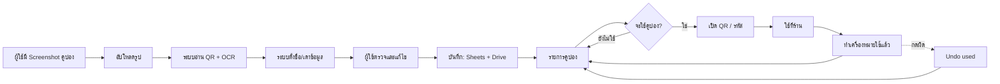
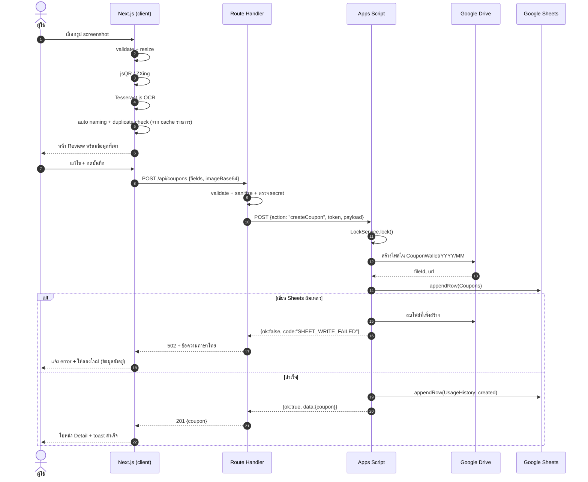
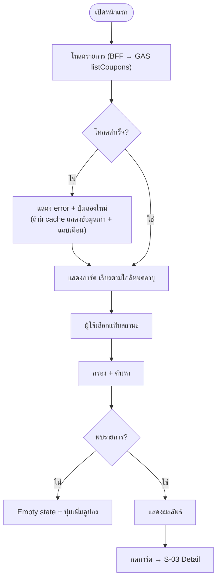
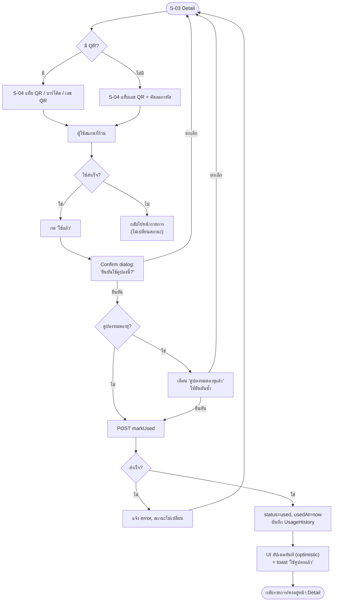
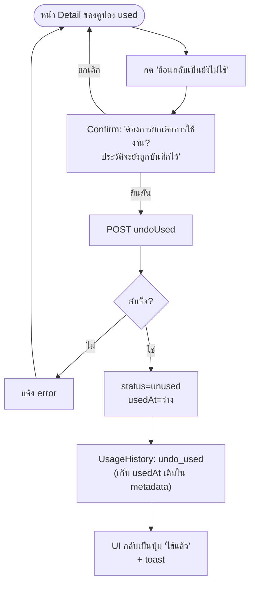
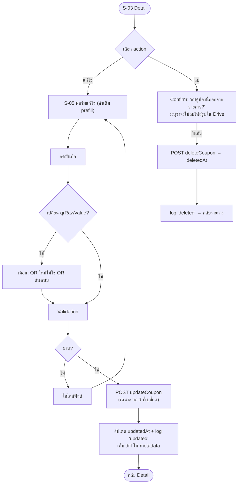
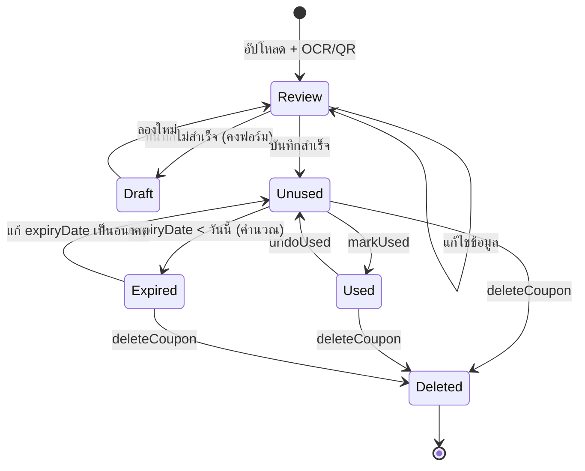

# Business Flow — Coupon Wallet

| รายการ | รายละเอียด |
|---|---|
| เวอร์ชัน | 0.1 (Draft) |
| วันที่ | 31 ตุลาคม 2026 |
| อ้างอิง | `01-BRD.md` |
| ขอบเขต | Phase 1 (MVP) |

---

## 1. ภาพรวม end-to-end



**หลักการสำคัญ:** ระบบไม่เขียนข้อมูลลง Sheets จนกว่าผู้ใช้จะยืนยันในหน้า Review (RULE-12) — ป้องกันข้อมูลขยะและคูปองซ้ำ

---

## 2. Flow 1 — เพิ่มคูปอง (BR-01 ถึง BR-05, BR-11, BR-13)

### 2.1 Flowchart

```mermaid
flowchart TD
  S([เริ่ม: กด "เพิ่มคูปอง"]) --> A["เลือกรูป: ไฟล์ / ลากวาง / วาง"]
  A --> B{"ไฟล์ถูกต้อง?<br/>ชนิด + ขนาด ≤ 10MB"}
  B -->|"ไม่"| B1["แจ้ง error + ให้เลือกใหม่"] --> A
  B -->|"ใช่"| C["ย่อขนาด + แสดง preview"]
  C --> D["อ่าน QR: jsQR"]
  D --> E{"พบ QR?"}
  E -->|"ไม่"| F["ลอง ZXing"]
  F --> G{"พบ QR?"}
  E -->|"ใช่"| H["เก็บ qrRawValue"]
  G -->|"ใช่"| H
  G -->|"ไม่"| I["qrRawValue = ว่าง<br/>แจ้ง 'ไม่พบ QR'"]
  H --> J["OCR: Tesseract.js (tha+eng)"]
  I --> J
  J --> K{"OCR สำเร็จ?"}
  K -->|"timeout/error"| K1["ใช้ผล QR เท่านั้น<br/>แจ้งให้กรอกเอง"] --> L
  K -->|"ใช่"| L["Auto naming + เดา merchant/ส่วนลด/วันหมดอายุ"]
  L --> M["ตรวจคูปองซ้ำ (qrRawValue / couponCode)"]
  M --> N{"ซ้ำ?"}
  N -->|"ใช่"| N1["เตือน + ลิงก์คูปองเดิม<br/>เลือก: ยกเลิก / บันทึกเป็นใบใหม่"]
  N -->|"ไม่"| O["หน้า Review (S-02)"]
  N1 -->|"บันทึกเป็นใบใหม่"| O
  N1 -->|"ยกเลิก"| X([จบ: ไม่บันทึก])
  O --> P{"ผู้ใช้กดบันทึก?"}
  P -->|"ไม่"| X
  P -->|"ใช่"| Q{"Validation ผ่าน?<br/>title required, ≤100, วันที่ถูกต้อง"}
  Q -->|"ไม่"| Q1["ไฮไลต์ฟิลด์ + ข้อความ"] --> O
  Q -->|"ใช่"| R["POST createCoupon:<br/>JSON + base64 รูป"]
  R --> S1["Apps Script: อัปโหลดรูปเข้า Drive"]
  S1 --> T{"อัปโหลดสำเร็จ?"}
  T -->|"ไม่"| T1["คืน error, ไม่เขียน Sheets"] --> O
  T -->|"ใช่"| U["เขียนแถวใน Coupons<br/>(LockService)"]
  U --> V{"เขียนสำเร็จ?"}
  V -->|"ไม่"| V1["ลบไฟล์ใน Drive (compensating)<br/>คืน error"] --> O
  V -->|"ใช่"| W["เขียน UsageHistory: created"]
  W --> Y["S-03 Detail<br/>แจ้ง 'บันทึกสำเร็จ'"]
  Y --> Z([จบ])
```

### 2.2 Sequence Diagram



### 2.3 สถานะการประมวลผลที่ผู้ใช้เห็น

| ขั้น | ข้อความ | ระหว่างรอ |
|---|---|---|
| 1 | กำลังตรวจรูป… | ≤ 1 วินาที |
| 2 | กำลังอ่าน QR Code… | ≤ 2 วินาที |
| 3 | กำลังอ่านข้อความ (ครั้งแรกอาจใช้เวลานาน) | ≤ 20 วินาที, แสดง progress ของ Tesseract |
| 4 | กำลังเตรียมข้อมูล… | ≤ 1 วินาที |
| 5 | กำลังบันทึก… | ≤ 8 วินาที |

> ระหว่างขั้น 3 ผู้ใช้ยังไม่สามารถกดบันทึกได้ แต่ยกเลิกได้ตลอด

### 2.4 Exception / Edge cases

| # | สถานการณ์ | พฤติกรรมที่ต้องการ |
|---|---|---|
| E-01 | ไฟล์ไม่ใช่รูป (เช่น PDF, .txt เปลี่ยนนามสกุล) | ปฏิเสธก่อนประมวลผล พร้อมบอกชนิดที่รองรับ |
| E-02 | ไฟล์ > 10 MB | ปฏิเสธ + แนะนำให้ crop |
| E-03 | รูปเป็น HEIC จาก iOS | แปลงเป็น WebP (fallback JPEG) ฝั่ง client ก่อน |
| E-04 | รูปไม่มี QR | บันทึกได้ โดย `qrRawValue` ว่าง และต้องมี `couponCode` หรือผู้ใช้ยืนยันว่าไม่มีรหัส |
| E-05 | QR อ่านได้แต่ payload เป็น binary/ไม่ใช้อักษร | เก็บเป็น base64 string, `qrType = unknown`, แสดงเป็นข้อความ escape |
| E-06 | OCR อ่านวันหมดอายุไม่ได้ | `expiryDate` ว่าง + ไฮไลต์ให้ผู้ใช้กรอก (ไม่บังคับ) |
| E-07 | OCR ได้วันเป็น พ.ศ. | แปลง −543 และแสดงข้อความ "ตีความเป็น 31/12/2026" ให้ยืนยัน |
| E-08 | ผู้ใช้ปิดหน้าเว็บระหว่างประมวลผล | ไม่มีข้อมูลถูกเขียน; ต้องเริ่มใหม่ |
| E-09 | บันทึกล้มเหลว (network/Sheets) | คงข้อมูลในฟอร์ม + ปุ่ม "ลองอีกครั้ง" (idempotency key กันสร้างซ้ำ) |
| E-10 | ผู้ใช้กดบันทึกซ้ำเร็ว ๆ | ปุ่ม disable + idempotency key |
| E-11 | รูปซ้ำกับคูปองเดิม | เตือน แต่ยอมให้บันทึกพร้อม mark `duplicateOf` |
| E-12 | ชื่อยาวเกิน 100 | ตัดอัตโนมัติ + แจ้ง |
| E-13 | ข้อความขึ้นต้นด้วย `=` (formula injection) | เติม `'` ก่อนเขียน Sheets |
| E-14 | Apps Script cold start / timeout | BFF retry 1 ครั้ง, ถ้ายังไม่ผ่านแจ้ง "ระบบตอบช้า ลองใหม่" |

---

## 3. Flow 2 — ดูรายการและกรอง (BR-06, BR-09, BR-14)



**ลำดับการเรียง:** คูปองยังไม่ใช้ที่ใกล้หมดอายุที่สุด → ยังไม่ใช้ที่ไม่มีวันหมดอายุ (ใหม่→เก่า) → ใช้แล้ว (ใหม่→เก่า)

**การกรองทำที่ client** เมื่อรายการ ≤ 500 แถว; เกินกว่านั้นส่งเงื่อนไขไปที่ API

---

## 4. Flow 3 — ใช้คูปอง (BR-07, BR-08, BR-10)



**หมายเหตุ:** เมื่อ used แล้ว ปุ่มหลักในหน้า Detail เปลี่ยนเป็น "คูปองนี้ใช้แล้ว" + ลิงก์ "ย้อนกลับเป็นยังไม่ใช้"

---

## 5. Flow 4 — Undo Used (BR-08, D-03)



**กฎ:** undo ได้ไม่จำกัดจำนวนครั้ง แต่ทุกครั้งต้องมี log; ไม่ลบ log เก่า

---

## 6. Flow 5 — แก้ไข / ลบ (BR-11, BR-12)



**ห้ามแก้:** `couponId`, `createdAt`, `status` (แก้ผ่าน flow ใช้/undo เท่านั้น), `ocrTextRaw`

---

## 7. State Diagram



> `Expired` เป็น pseudo-state ที่คำนวณจาก `expiryDate` ไม่ได้เก็บใน `status` (ดู BRD §6.2 BR-09)

---

## 8. Screen Inventory (สำหรับขั้นออกแบบ UI)

| ID | หน้าจอ | องค์ประกอบหลัก | อ้างอิง |
|---|---|---|---|
| S-01 | `/user/{id}` Coupon List | แท็บสถานะ, ค้นหา, สลับ grid 2 คอลัมน์/list, FAB เพิ่ม, empty state | BR-06, BR-09, BR-17 |
| S-02 | Add — Review | preview รูป (ซูม), ฟอร์มที่เดาแล้ว, ป้าย confidence ต่ำ, ปุ่มบันทึก/ยกเลิก | BR-01..04, BR-11 |
| S-03 | Coupon Detail | รูปต้นฉบับ, ข้อมูลทั้งหมด, badge สถานะ/หมดอายุ, ปุ่มใช้แล้ว, timeline | BR-07, BR-08, BR-10 |
| S-04 | QR / Barcode / Code | 3 แท็บ: เลข QR, บาร์โค้ด Code 128, QR ≥ 280px + คัดลอก/เต็มหน้าจอ | BR-07 |
| S-05 | Edit Coupon | ฟอร์มเดียวกับ S-02 (โหมดแก้ไข) | BR-11 |
| S-06 | Usage History | รายการ log ตามเวลา + action + ค่าเดิม/ใหม่ | BR-10 |
| S-07 | `/user` User Entry | ช่องกรอก id, ตัวอย่าง | BR-17 |
| S-09 | `/` Create QR | ช่องข้อความ, แท็บ QR/บาร์โค้ด, คัดลอก/แชร์ลิงก์ | BR-07 |
| S-10 | `/share/{couponId}` | คูปองอ่านอย่างเดียว + QR/บาร์โค้ด/รหัส + ลิงก์แชร์ | BR-20 |

**Navigation:** S-09 → S-07 → S-01 → S-02 → S-03 → S-04 / S-05 / S-06

---

## 9. ลำดับเวลาโดยรวม (Happy Path)

| เวลา | ผู้ใช้ | ระบบ |
|---|---|---|
| 0s | กดเพิ่มคูปอง เลือกรูป | validate + preview |
| 1s | รอ | อ่าน QR (jsQR → ZXing) |
| 2s | รอ | เริ่ม OCR + progress |
| 8s | เห็นข้อมูลที่เดา | auto naming + duplicate check |
| 12s | แก้ชื่อ/วันหมดอายุ | validation สด |
| 18s | กดบันทึก | upload Drive + append Sheets |
| 22s | เห็นหน้า Detail + toast | คืน coupon ที่บันทึก |
| 25s | เปิด QR ใช้ที่ร้าน | วาด QR จาก qrRawValue |
| 90s | กดใช้แล้ว ยืนยัน | markUsed + history |
| 95s | เห็นสถานะ used | อัปเดต UI + log |

---

## 10. Mapping Flow → BR → AC

| Flow | BR ที่เกี่ยวข้อง | AC ที่ต้องผ่าน |
|---|---|---|
| 1. Add Coupon | BR-01, 02, 03, 04, 05, 11, 13 | AC-01..AC-23 |
| 2. List & Filter | BR-06, 09, 14 | AC-24..AC-30 |
| 3. View QR & Use | BR-07, 08, 10 | AC-31..AC-37 |
| 4. Undo Used | BR-08, 10 | AC-38..AC-40 |
| 5. Edit / Delete | BR-11, 12 | AC-41..AC-44 |
| 0. Entry / Users | BR-17 | AC-53..AC-54 |
| Cross-cutting | RULE-*, NFR-* | AC-45..AC-50 |
